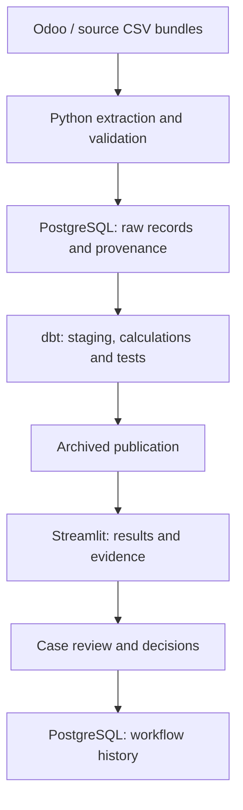

# Money Trail

**Trace a financial result from its source records to a documented review.**

Money Trail is a local financial control application built with Python, PostgreSQL, dbt and Streamlit. It compares invoices with allocated payments, explains outstanding balances, and keeps the supporting records and human review history together.

The project includes synthetic reference datasets and a local Odoo integration. It is a portfolio project with explicitly scoped verification, not a claim of production certification.

## What it does

- Calculates invoice balances from invoices, eligible payment allocations and credit notes.
- Preserves source records, file fingerprints and calculation evidence.
- Highlights results requiring review and incomplete source coverage.
- Supports case assignment, comments, proposals and independent approval or rejection.
- Archives published results so a failed subsequent calculation does not replace the last validated version.
- Includes settlement reconciliation models for imported bank movements and confirmed allocations.

**Current integration boundary:** the Odoo invoice/payment import does not establish that money reached a bank account. Bank confirmation requires bank-originated data and verified links. Candidate bank matches are suggestions, not automatic confirmation. Approving a proposal does not update Odoo.

## Architecture

| Component | Responsibility |
|---|---|
| Python | Extract, validate and import data; orchestrate publication |
| PostgreSQL | Store source evidence, calculated data and workflow state |
| dbt | Build SQL models and run data tests |
| Streamlit | Explain results and support the review process |
| Docker Compose | Run the local PostgreSQL service |

## Start here

- [Windows setup](docs/GETTING_STARTED.md)
- [How to use the application](docs/USER_GUIDE.md)
- [Architecture and financial semantics](docs/ARCHITECTURE.md)
- [Odoo integration and limitations](docs/ODOO_INTEGRATION.md)
- [Validation evidence and scope](docs/VALIDATION.md)
- [Contribution guidelines](CONTRIBUTING.md)
- [Security and data handling](SECURITY.md)

Existing numbered documents in `docs/` describe earlier milestones. Use the guides above as the current entry point; historical test counts and early integration status in milestone documents refer to those milestones.

## Local Odoo run

A Windows run reported on 6 October 2026 used Odoo Community 18.0-20250721 and PostgreSQL 17:

| Result | Observed value |
|---|---:|
| Imported records | 89 |
| Published invoice results | 18 |
| Published settlement results | 0 |
| dbt models built | 18 |
| dbt data tests passed | 21 |

These are development-run results, not throughput measurements or a guarantee of support for every accounting scenario. The public repository must not contain the private source exports used in that run.

## Repository map

| Directory | Contents |
|---|---|
| `src/money_trail/` | Import, reconciliation evidence, publication, authentication and workflow |
| `dbt/` | SQL transformations and data tests |
| `sql/` | Database initialization and migrations |
| `ui/` | Streamlit application and styles |
| `scripts/` | Local setup, extraction, build and validation commands |
| `fixtures/` | Synthetic scenarios and expected results |
| `data/reference_v1/` | Synthetic reference bundle |
| `tests/` | Python tests |
| `docs/` | User and engineering documentation |

## Author

Ilyass Chakir · [GitHub](https://github.com/ilyass74)
